<p align="center">
  
</p>

<p align="center">
  
  
  
  
  
</p>

---

## Executive Summary / Overview
### Problem Statement & Context
Generative Artificial Intelligence is transforming computational creativity, language modeling, and synthetic data generation. However, training generative architectures—whether balancing the minimax game of Generative Adversarial Networks (GANs), optimizing the Evidence Lower Bound (ELBO) in Variational Autoencoders (VAEs), or fine-tuning Large Language Models (LLMs)—requires deep mathematical discipline across loss formulations and latent distributions.

### Solution Overview
This repository represents an extensive **Generative AI Research & Development Suite** featuring **11 advanced Jupyter notebooks**. It spans image synthesis using **Deep Convolutional GANs (DCGAN)** on Fashion-MNIST, probabilistic latent representation modeling with **Variational Autoencoders (VAE)** on MNIST, rigorous **GAN vs. VAE comparative evaluations**, and autoregressive **GPT-2 Fine-Tuning** using the Hugging Face `transformers` and `datasets` libraries.

---

## Interactive Table of Contents
- [Executive Summary / Overview](#executive-summary--overview)
- [Key Features & Capabilities](#key-features--capabilities)
- [System Architecture / Pipeline](#system-architecture--pipeline)
- [Tech Stack Breakdown](#tech-stack-breakdown)
- [Reproducible Quickstart & Setup](#reproducible-quickstart--setup)
- [Project Directory Layout](#project-directory-layout)
- [Author & Contributions](#author--contributions)

---

## Key Features & Capabilities
- **Deep Convolutional GANs (DCGAN):** Generator-Discriminator adversarial minimax training on Fashion-MNIST utilizing transposed convolutions and LeakyReLU non-linearities.
- **Variational Autoencoders (VAE):** Encoder-Decoder architecture trained by optimizing the combined Reconstruction Loss and Kullback-Leibler (KL) Divergence over standard Gaussian latent priors.
- **Empirical GAN vs. VAE Comparative Study:** Quantitative and visual assessment contrasting sharp adversarial sample generation against smooth, continuous VAE latent space interpolations.
- **GPT-2 Causal LM Fine-Tuning:** Domain adaptation of OpenAI's GPT-2 architecture using Hugging Face `Trainer`, custom tokenizer pipelines, and gradient accumulation.
- **Transfer Learning & Feature Extraction:** Deep convolutional backbone evaluation utilizing pre-trained PyTorch and TensorFlow models.

---

## System Architecture / Pipeline

```mermaid
flowchart TD
    subgraph GAN_Pipeline[DCGAN Adversarial Minimax Loop]
        Z[Latent Noise Vector z] --> G[Generator Network]
        G --> Fake[Synthetic Sample]
        Real[Real Dataset Sample] --> D[Discriminator Network]
        Fake --> D
        D --> Loss[Adversarial Minimax Loss]
        Loss --> Backprop[Backpropagation & Weight Updates]
    end

    subgraph VAE_Pipeline[Variational Autoencoder Pipeline]
        InputX[Input Image x] --> Encoder[Encoder Backbone]
        Encoder --> LatentParams["Parameters: mu (Mean), log(sigma^2)"]
        LatentParams --> Reparam["Reparameterization: z = mu + sigma * epsilon"]
        Reparam --> Decoder[Decoder Network]
        Decoder --> ReconLoss[Reconstruction + KL Divergence Loss]
    end

    subgraph LLM_Pipeline[GPT-2 Fine-Tuning]
        TextCorpus[Text Dataset] --> Tokenizer[GPT-2 BPE Tokenizer]
        Tokenizer --> TransformerBlocks[Causal Self-Attention Blocks]
        TransformerBlocks --> CausalLoss[Cross-Entropy Causal Loss]
    end
```


---

## Tech Stack Breakdown
| Layer | Technology | Implementation Details |
| :--- | :--- | :--- |
| **Languages** | Python 3.10+ | Scientific computing and tensor modeling runtime |
| **Libraries** | PyTorch, TensorFlow 2.x, Hugging Face `transformers`, `datasets` | Autograd, convolutional layers, causal transformers |
| **Tools** | Jupyter Lab, Matplotlib, PIL, Scikit-Learn | Latent interpolation grids, image tensors, loss logging |
| **Architecture** | Deep Generative Models (DCGAN, VAE, Causal LLM) | Adversarial game, variational inference, autoregressive attention |

---

## Reproducible Quickstart & Setup
```bash
# 1. Clone repository
git clone https://github.com/suryateja-155/GEN-AI.git
cd GEN-AI

# 2. Virtual environment setup
python -m venv venv
.\venv\Scripts\activate   # On Windows

# 3. Install Generative AI dependencies
pip install torch torchvision tensorflow transformers datasets matplotlib numpy pillow

# 4. Explore generative notebooks
jupyter lab "Assignment_4_DCGAN_Fashion_MNIST.ipynb"
jupyter lab "Assignment_8_VAE_MNIST (1).ipynb"
jupyter lab "Assignment_11_GPT2_Fine_Tuning (2).ipynb"
```

---

## Project Directory Layout
```text
GEN-AI/
├── Assignment_4_DCGAN_Fashion_MNIST.ipynb   # DCGAN training on Fashion-MNIST dataset
├── Assignment_8_VAE_MNIST (1).ipynb         # Variational Autoencoder implementation on MNIST
├── Assignment_10_GAN_vs_VAE (2).ipynb       # Comparative latent space & generative analysis
├── Assignment_11_GPT2_Fine_Tuning (2).ipynb # GPT-2 domain adaptation with Hugging Face
├── AI_Assignment_1.ipynb                     # Foundational autoencoders and representation learning
├── AI_Assignment_2.ipynb                     # Transformer tokenization and causal attention passes
├── AI_Assignment_3.ipynb                     # Text generation sampling strategies (top-k / top-p)
├── Assignment_5.ipynb                        # Advanced deep generative experiments
├── Assignment_6_.ipynb                       # Transfer learning & feature extraction pipelines
├── Assignment_7_.ipynb                       # Deep convolutional generative experiments
└── README.md                                 # Technical research documentation & architecture guide
```

---

## Author & Contributions

**Gettupalli Surya Teja**  
- GitHub Profile: [@suryateja-155](https://github.com/suryateja-155)  
- Portfolio Index: [Gettupalli-Surya-Teja](https://github.com/suryateja-155/Gettupalli-Surya-Teja)

Contributions, issue reports, and feedback are always welcome! Feel free to open an issue or pull request.

<p align="center">
  
</p>
